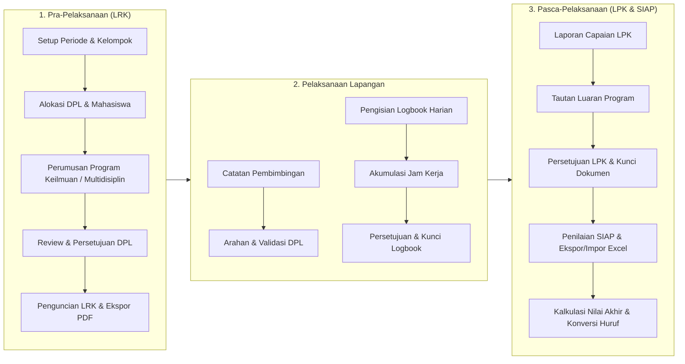

# SIKKN (Sistem Informasi Kuliah Kerja Nyata)

SIKKN adalah platform manajemen dan pemantauan Kuliah Kerja Nyata (KKN) Universitas Diponegoro. Seluruh siklus fieldwork akademik dengan platform digital mulai dari perencanaan program kerja, pelaksanaan harian, hingga pelaporan akhir, luaran program, dan evaluasi nilai berbasis SIAP.

Aplikasi ini dibangun menggunakan arsitektur modern berbasis peran (Role-Based Architecture) dengan stack Laravel 13, Livewire 4, Livewire Flux UI, dan Tailwind CSS v4.

---

## Sorotan Siklus KKN (End-to-End Workflow)

Sistem mengintegrasikan tiga fase utama pelaksanaan KKN ke dalam satu ekosistem terpadu:

---

## Fitur dan Pengalaman Pengguna Berdasarkan Peran

### 1. Mahasiswa
- **Perencanaan Program Kerja (LRK):** Merumuskan usulan program keilmuan mandiri atau bergabung ke dalam tema program multidisiplin inisiasi DPL, lengkap dengan sasaran, metode, tanggal pelaksanaan, dan target luaran.
- **Logbook Harian Berintegritas Tinggi:** Mencatat aktivitas harian dengan waktu mulai dan selesai (`H:i`) yang secara otomatis menghitung akumulasi jam kerja efektif. Dibatasi tepat 1 log per tanggal dalam rentang periode aktif kelompok.
- **Catatan Pembimbingan (Mentoring Log):** Mendokumentasikan materi bimbingan berkala dan mencatat arahan tindak lanjut langsung dari DPL.
- **Pelaporan Realisasi (LPK) & Luaran Eksternal:** Melaporkan tingkat capaian program, analisis kendala, solusi yang diterapkan, serta menautkan bukti luaran (dokumen Google Drive, video YouTube, foto kegiatan) tanpa membebani media penyimpanan server.
- **Dokumen Resmi Berformat PDF:** Mengunduh dokumen resmi LRK, LPK, rekapan logbook, dan lembar pembimbingan bertanda tangan digital.

### 2. Dosen KKN
- **Manajemen Kelompok & Kordes:** Memantau susunan anggota kelompok dan menetapkan atau mengganti Koordinator Desa (Kordes / Student Leader) melalui dialog konfirmasi terproteksi.
- **Inisiasi Tema Multidisiplin:** Membuat dan mengelola tema program multidisiplin kelompok yang siap dipilih dan dijalankan oleh mahasiswa lintas program studi.
- **Penelaahan Bertingkat (Review & Approval):** Memeriksa usulan program kerja pada tahap LRK dan laporan realisasi pada tahap LPK dengan opsi persetujuan atau permintaan revisi berpenjelasan.
- **Verifikasi Logbook & Pembimbingan:** Memvalidasi laporan harian mahasiswa secara individual atau serentak, serta memberikan feedback resmi pada catatan pembimbingan.
- **Engine Penilaian SIAP:** Menilai kinerja mahasiswa berdasarkan komponen bobot penilaian aktif (Aktivitas Partisipatif, Hasil Proyek, Tugas, Quiz, UTS, UAS). Mendukung pengisian langsung via formulir web atau batch via ekspor-impor berkas Excel (`.xlsx`).

### 3. Admin P2KKN
- **Konfigurasi Periode Operasional:** Mengatur semester, tahun ajaran, dan tanggal berlaku KKN.
- **Manajemen Roster & Alokasi:** Mengelola penempatan mahasiswa dan penetapan DPL pendamping pada setiap kelompok desa/kelurahan.
- **Kontrol Status Dokumen (Locking Mechanism):** Mengunci status pengajuan LRK dan LPK saat tenggat waktu berakhir untuk menjaga keaslian data evaluasi.
- **Pusat Data Master:** Mengelola data Fakultas, Program Studi, Tipe Kelompok, Tipe Program, Kategori SDG, dan Bobot Komponen Nilai SIAP.

### 4. Observer Prodi & Fakultas
- **Pengawasan Terfokus Program Studi:** Memantau kemajuan, aktivitas harian, bimbingan, kelengkapan berkas, dan perolehan nilai mahasiswa yang berada di bawah program studi terkait.
- **Pemantauan Lintas Fakultas:** Memperoleh visibilitas menyeluruh terhadap seluruh kelompok, DPL, program kerja, dan mahasiswa dalam naungan fakultas.

---

## Engineering Highlights

- **Domain-Driven Livewire Separation:** Seluruh komponen antarmuka dipisahkan secara tegas berdasarkan namespace peran (`app/Livewire/Admin`, `Dpl`, `Mahasiswa`, `Observer`), mencegah kebocoran logika antar-otoritas.
- **High-Performance Excel Processing:** Layanan `GradeExcelService` memanfaatkan PhpSpreadsheet dengan format terstruktur untuk mendukung pembacaan dan penulisan nilai massal puluhan hingga ratusan mahasiswa secara instan.
- **Zero-Storage External Output Architecture:** Luaran program mahasiswa (video presentasi, dokumen PDF laporan, dokumentasi visual) diverifikasi dan disajikan melalui URL eksternal terpercaya, menjaga beban disk server tetap ringan.
- **Automated Document Generation Pipeline:** Integrasi DomPDF teroptimasi menghasilkan berkas cetak siap pakai (A4 standar) untuk dokumen LRK, LPK, logbook, dan mentoring lengkap dengan rekapitulasi data dan tanda tangan.
- **Strict Academic Constraints:** Validasi tingkat basis data dan model memastikan aturan akademik terpenuhi: satu catatan harian per tanggal, verifikasi tanggal dalam periode kelompok, dan penguncian data otomatis pasca-persetujuan.

---

## Tech Stack

| Lapisan | Teknologi | Catatan Penggunaan |
| :--- | :--- | :--- |
| **Backend Core** | PHP 8.3+, Laravel 13.x | Framework aplikasi web utama |
| **Reactivity** | Livewire 4.x, Alpine.js | State reaktif server-side tanpa SPA overhead |
| **UI Components** | Livewire Flux UI 2.x | Pustaka komponen antarmuka resmi Livewire |
| **Styling** | Tailwind CSS v4 | Utilitas styling modern dengan performa tinggi |
| **Authentication** | Laravel Fortify | Autentikasi berbasis session yang aman |
| **Reporting / PDF** | DomPDF (`barryvdh/laravel-dompdf`) | Engine rendering laporan resmi cetak |
| **Spreadsheet** | PhpSpreadsheet | Ekspor dan impor massal penilaian SIAP |
| **Testing** | PHPUnit 12.x | Rangkaian 120+ pengujian fitur dan integrasi domain |

---

## License

Platform ini dikembangkan untuk kebutuhan akademik institusi dan dilindungi di bawah lisensi [MIT](https://opensource.org/licenses/MIT).
